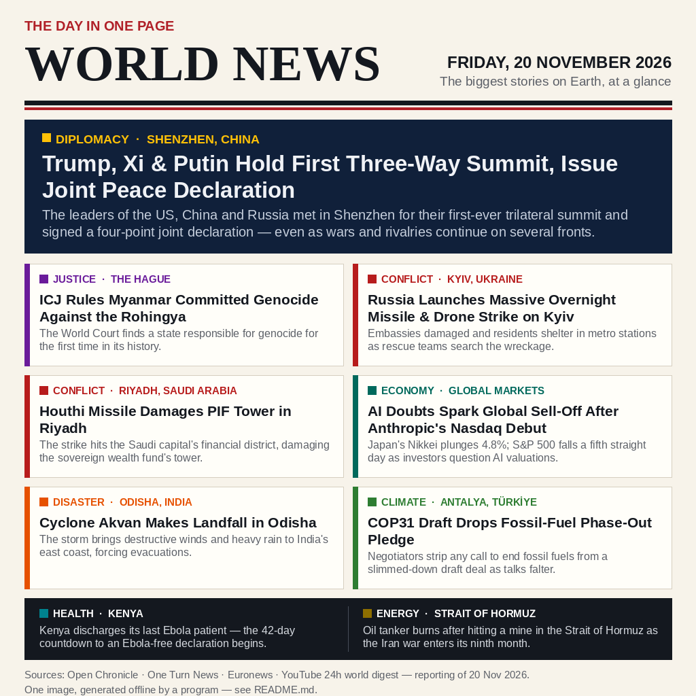

# World News in One Image — Friday, 20 November 2026

A program that sums up the world news of **Friday, 20 November 2026** in a
single image: a broadsheet-style front page, generated entirely offline.

Entry for the make.fun bounty
[**"Sum up 20 November's world news in one image"**](https://make.fun/bounty/news-image-20261120)
($250 prize pool, 50 paid places; deadline Sun 22 Nov 2026, 00:00 UTC).



## Run it

```bash
pip install -r requirements.txt   # Pillow
python3 main.py                   # writes /output/entry.png
python3 main.py some/path.png     # or choose the output path
```

* Python 3.13 (works on 3.10+), Pillow is the only dependency.
* **No network** is used at render time — the day's news is bundled in
  `data/news.json` and the fonts are bundled in `fonts/`.
* **Deterministic** — the program has no randomness, clock or environment
  input; two runs write byte-identical PNG files (verified with `cmp`).

## Bounty requirements (from the bounty page, checked 21 Nov 2026)

* The entry is a **program** (`main.py` in the repo root) that writes one
  image to `/output/entry.png`.
* The image is a whole **PNG or JPEG, at most 1 MiB and 1024×1024 px**.
  → This program writes a 1024×1024 PNG of ~150 KB.
* **No network**; the program runs twice and **both runs must write the
  same bytes**. → Verified locally.
* Deliverable is a **public GitHub repository** (created after the
  competition opened) under an **OSI-approved license** (this repo: MIT),
  with the program at `main.py` (Python) in the root.
* The **AI coding-agent transcripts** of the sessions that built it are
  uploaded with each submission → see `transcripts/`.
* Judging: an AI judge compares entered images two at a time and ranks
  them by how well each image itself sums up the day's world news.
* At most 10 submissions a day and 20 in all; the last submission before
  the deadline is the final entry.

## What's in the image

One hero story plus eight more, chosen from the day's reporting across
independent digests (see Sources):

| Slot | Category | Story |
|---|---|---|
| Hero | Diplomacy — Shenzhen | Trump, Xi & Putin hold first three-way summit, issue joint peace declaration |
| Card | Justice — The Hague | ICJ rules Myanmar committed genocide against the Rohingya |
| Card | Conflict — Kyiv | Russia launches massive overnight missile & drone strike on Kyiv |
| Card | Conflict — Riyadh | Houthi missile damages PIF Tower in Riyadh |
| Card | Economy — Global markets | AI doubts spark global sell-off after Anthropic's Nasdaq debut (Nikkei −4.8%) |
| Card | Disaster — Odisha | Cyclone Akvan makes landfall in Odisha, India |
| Card | Climate — Antalya | COP31 draft drops fossil-fuel phase-out pledge |
| Brief | Health — Kenya | Last Ebola patient discharged; 42-day countdown begins |
| Brief | Energy — Strait of Hormuz | Tanker burns after hitting a mine as Iran war enters month nine |

## Files

```
main.py            the program (Pillow renderer)
data/news.json     the day's headlines, summaries, categories, sources
fonts/             Liberation Sans + Liberation Serif Bold (SIL OFL 1.1),
                   bundled so rendering is identical anywhere
output.png         sample output of the current build
requirements.txt   Pillow
transcripts/       agent session notes for this build
LICENSE            MIT
```

## Sources (reporting of 20 November 2026)

* Open Chronicle — *Global News Brief, November 20, 2026*
* One Turn News — *World news today: Genocide Ruling, Shenzhen Summit, AI Sell-Off*
* Euronews — news bulletins of 20 November 2026
* *What Happened in the World in the Last 24 Hours* — 20 Nov 2026 digest (YouTube)

Headlines were cross-checked across at least two of these digests before
being included; wording in the image is paraphrased, not copied.
